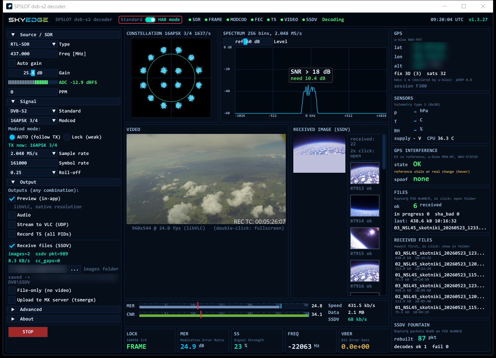
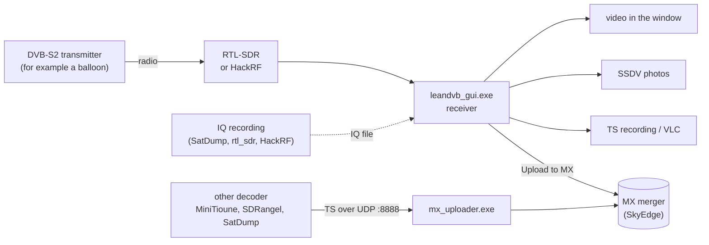
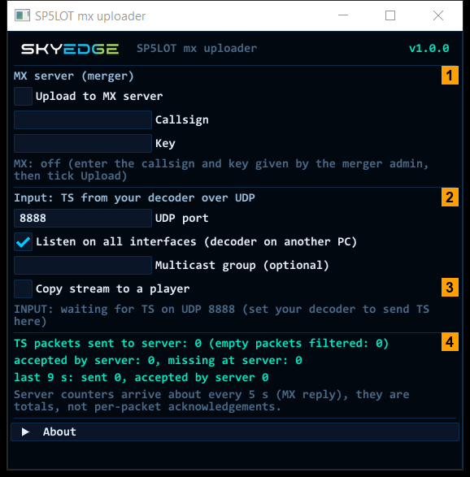

# SP5LOT DVB-S2 decoder and MX Uploader (SkyEdge)

A Windows receiver and decoder for **DVB-S2** transmissions. It shows the live video,
saves the **SSDV photos** sent by the transmitter and can forward the stream to the **SkyEdge MX merger**,
which combines the reception of many ground stations. It works with an **RTL-SDR** dongle or a **HackRF One**.
One of its uses is video from **high-altitude balloons**.

**[MX Uploader](#mx-uploader)** is a separate program in the same release, with its own small ZIP: it sends the
stream of *other* DVB-S2 decoders (MiniTioune, SDRangel, SatDump and others) to the same MX merger.

Inside the receiver, the DVB-S2 demodulator is **leandvb** from [leansdr](https://github.com/pabr/leansdr) by pabr,
and the LDPC decoder is `ldpc_tool` by Ahmet Inan (adapted by pabr), both with our patches. This project adds the Windows receiver
window, SDR control, SSDV photos and the MX upload. It is an unofficial program, not affiliated with the leansdr
author: please report problems here, not upstream.

## What it does

- Receives **DVB-S2** (QPSK, 8PSK, 16APSK, 32APSK) from an **RTL-SDR** or a **HackRF One**, or decodes a recorded IQ file.
- Shows the **live video** with sound (built-in VLC engine). The preview restarts by itself when the picture freezes.
- **Standard / HAB mode** switch: *Standard* is plain DATV video reception (for example QO-100, with an LNB enter the IF), *HAB mode* also receives what a balloon transmitter sends next to the video: **SSDV photos** (with RaptorQ repair packets), **files** (RaptorQ fountain code, checked with SHA-256) and **GPS telemetry** with sensors and the GPS interference state, see [Files and photos from a balloon transmitter](#files-and-photos-from-a-balloon-transmitter-hab-mode).
- Clear status: a lamp for each stage, constellation, spectrum, SNR with the level needed for the current MODCOD, MER and CNR bars, bit rate of the stream, UTC clock and input level.
- Outputs in any combination: preview, stream to VLC over UDP, TS recording, and **upload to the SkyEdge MX merger**, which combines the reception of many ground stations (optionally with the station position, which is not shown publicly).
- Steady long runs: it follows a change of MODCOD by the transmitter, recovers by itself after a fade or a radio or USB problem, and has an optional automatic gain for HackRF and RTL-SDR.
- Runs on modest PCs: the demodulator comes in two builds, with and without AVX2, and the receiver picks the right one.

## Download

Get the ZIP from **[Releases](../../releases/latest)**. There is no installer: everything is in one folder.

What changed in each version is listed in the notes of each **[release](../../releases)**.

| File in the release | For whom |
|---|---|
| `SP5LOT-dvbs2-decoder-<version>-win64.zip` | the receiver with RTL-SDR or HackRF |
| `SP5LOT-mx-uploader-<version>-win64.zip` | MX Uploader, a separate program for stations that receive with another decoder (under 1 MB) |
| `SP5LOT-dvbs2-sample-iq.zip` | a 19.5 s sample recording to try [decoding a recorded IQ file](#decoding-a-recorded-iq-file) |
| `SP5LOT-dvbs2-decoder-<version>-source.zip` | source code of the receiver, for developers |
| `SP5LOT-mx-uploader-<version>-source.zip` | source code of MX Uploader, for developers (from 1.0.2) |

**You need**

- Windows 10, 64-bit (tested on three PCs). Windows 11 should work but has not been tested.
- An RTL-SDR dongle or a HackRF One with the **WinUSB** driver. Install it once with
  [Zadig](https://zadig.akeo.ie): pick the device, choose *WinUSB*, click *Install Driver*.
- VLC does not need to be installed: the video preview uses the VLC engine in the folder `vlc` of the ZIP.
  Keep that folder next to `leandvb_gui.exe`.

**Install**

1. Extract **all** files from the ZIP, with the `vlc` folder, into one folder where you can write, for example on the Desktop.
   Not into `C:\Program Files`: the programs save their settings next to the exe.
2. Run `leandvb_gui.exe` (the receiver), or `mx_uploader.exe` from the MX Uploader ZIP.
3. The programs are not signed, so Windows may show *"Windows protected your PC"*:
   click *More info*, then *Run anyway*.
4. On a slow PC the first start of the video preview can take a while, because VLC loads its plugins. Later starts are faster.

## How it fits together

## The receiver window

| | What it is | What to do |
|---|---|---|
| **1** | **Source / SDR** | Choose RTL-SDR or HackRF, type the frequency in MHz (default 437.000), set the gain. Or choose *IQ file* to decode a recording. Other radios marked *(exp.)* may also appear in the list: they are experimental and have not been tested. |
| **2** | **Signal** | DVB-S2, the MODCOD of the transmitter (default QPSK 3/4), symbol rate (default 500000). *Lock (weak)* with *Follow TX changes* is the default, see below. |
| **3** | **Output** | What to do with the stream, in any combination: preview, VLC, TS recording, SSDV photos, upload to MX. |
| **4** | **Constellation** | Four clean dots = a good QPSK signal. A round cloud = too weak. |
| **5** | **Spectrum** | The transmitter is the hump in the middle. *Level* moves the scale. |
| **6** | **Video** | Live video. Double-click for full screen. |
| **7** | **Received image (SSDV)** | The photo being received now and the list of photos received since the start. Double-click a thumbnail to open it. |
| **8** | **Status** | **LOCK**: *FRAME* (green) means data is decoded, *CARRIER* means the signal is found but not decoded yet. **MER**: signal quality in dB, more is better (for QPSK 3/4 the DVB-S2 standard gives about 4 dB). **SS**: signal strength. **FREQ**: carrier offset. **VBER**: bit errors, 0 is clean. |

**Standard / HAB mode.** The switch at the top of the window, next to the program name: *Standard* (default) is plain DATV video; *HAB mode* adds SSDV photos, files and GPS telemetry from balloon transmitters (panels **7** and the telemetry tiles). It can be switched during reception; the reception restarts for a moment.

**Modcod mode.** A transmitter usually keeps one MODCOD (a balloon for the whole flight), so the receiver decodes only the
selected one (*Lock*). If the transmitter uses another MODCOD, *Follow TX changes* switches the receiver
to it by itself within a few seconds (short restart), and the choice is remembered. *AUTO* accepts every
MODCOD at once, for transmitters that change it often.

## Quick start

1. Plug in the SDR and start `leandvb_gui.exe`.
2. **1**: choose the SDR and type the frequency of the transmitter.
3. **2**: check the symbol rate (ask the operator of the transmitter, for example 500000 or 250000).
4. For a balloon transmitter with SSDV photos, switch the top of the window to **HAB mode**.
5. Press **START**. After a few seconds LOCK shows *FRAME*, the video appears and (in HAB mode) photos start to arrive.

## Outputs

- **Preview (in-app)**: video in the window.
- **Stream to VLC (UDP)**: the full transport stream to an address and port, default `127.0.0.1:1234`.
  In VLC: *Media > Open Network Stream* > `udp://@:1234`. It can also go to another PC.
- **Record TS (all PIDs)**: a new file `rec_<date>.ts` at every start, never overwritten. Folder: *Videos\SkyEdge DVB*.
- **Receive files (SSDV)**, HAB mode only: photos sent by the transmitter, saved as `rx_NNNN.jpg`. Folder: *Pictures\SkyEdge DVB\SSDV*.
  The *...* button chooses another folder.
- **Upload to MX server (tsmerge)**: tick it and enter your station **callsign** and **key**. Both are empty after
  installation; the operator of the MX merger gives them to you. The status line shows when the server has accepted your station.

## Files and photos from a balloon transmitter (HAB mode)

In HAB mode the receiver also takes the data that a SkyEdge balloon transmitter sends next to the video. The tiles on the right of the window show it:

- **Files.** The transmitter can send any file, for example a full-size photo or a log. It is sent with a RaptorQ fountain code: the receiver does not need every packet, only enough of them, so a file still arrives complete when some packets are lost in a fade. **FILES** shows how many files are complete, the file being received now with a progress bar, and the last one. Every file is checked against its SHA-256 sum before it is saved; `sha_bad` counts parts that failed the check (a file that fails is not saved). Files are saved in the subfolder `pliki` of the SSDV folder, with the name given by the transmitter. **RECEIVED FILES** lists the files of this run, newest first; double-click a name to show it in its folder.
- **SSDV photos with repair packets.** The transmitter can add RaptorQ repair packets to the SSDV photos. When some photo packets are lost, the receiver rebuilds them from the repair packets, so more photos come out complete. **SSDV FOUNTAIN** shows how many packets were rebuilt (*rebuilt*) and how many repair attempts worked (*decodes ok*) or not (*fail*).
- **GPS**, **SENSORS** and **GPS INTERFERENCE**: the position and telemetry of the transmitter, when it sends them.

A plain DATV transmitter does not send these streams; then the tiles show *waiting*.

## Decoding a recorded IQ file

The receiver can decode a recording instead of a live SDR, for example a file saved by
SatDump, rtl_sdr or a HackRF.

1. **1** *Source / SDR*, *Type*: choose **IQ file** and pick the file with the **...** button.
   The format and the sample rate are read from the file name, for example
   `2025-05-10_15-16-13_1536000SPS_437200000Hz.cs8` (SatDump): `.cs8`/`.s8`, `.u8`/`.cu8` (rtl_sdr),
   `.cs16`/`.s16`, `.cf32`/`.f32`, and `1536000SPS` or `2048ksps` for the sample rate.
   The line *detected:* shows the result.
2. **2** *Signal*: the symbol rate as transmitted (for example 500000). The transmitter should be near
   the centre of the recording.
3. Press **START**. With the preview on, the file plays at its real speed; *Loop* repeats it.
   No lock? Try *Swap I/Q* in the *Advanced* section (some recordings have the spectrum mirrored).

When decoding a file, the MODCOD is always detected automatically (*AUTO*) and **nothing is sent to
the MX merger**, even with *Upload to MX server* ticked.

**Sample recording:** `SP5LOT-dvbs2-sample-iq.zip` on the release page: 19.5 s of a real signal from the
SkyEdge transmitter (QPSK 3/4, 500000 symbols/s, recorded with an RTL-SDR at 2.048 MS/s). Choose it as the
IQ file and press START: LOCK shows *FRAME* and the video shows clouds seen from a balloon.

## MX Uploader

For stations that already receive with another DVB-S2 decoder (MiniTioune, SDRangel, SatDump or any decoder
that can send the transport stream over UDP): MX Uploader takes that stream and sends it to the SkyEdge MX merger.
One small program, no installation: `mx_uploader.exe` is in its own small ZIP, `SP5LOT-mx-uploader-<version>-win64.zip`
(up to 1.0.1 it was also inside the receiver ZIP).

| | What it is | What to do |
|---|---|---|
| **1** | **MX server (merger)** | Enter the callsign and key given by the merger admin and tick *Upload to MX server*. The line below shows the state: *ONLINE, station accepted* means it works. |
| **2** | **Input** | In your decoder, send the TS over UDP to this port (default `8888`, so `127.0.0.1:8888` on the same computer). *Listen on all interfaces* (ticked by default) lets a decoder on another computer send here; Windows may ask about the firewall on the first start. Multicast group is optional. |
| **3** | **Copy stream to a player** | Sends the same stream to `127.0.0.1:1235`, for example to VLC (`udp://@:1235`). |
| **4** | **Counters** | Packets sent to the server, accepted by the server and missing at the server. The server reports its counters about every 5 s. |

Several receivers at once: one copy per receiver, each with its own settings file and input port, for example
`mx_uploader.exe --config station2.ini`.

## Settings and logs

- Settings are saved next to the exe: `leandvb_gui_settings.ini` and `mx_uploader.ini`. They keep the folders,
  outputs, MX callsign and key, SDR and gain, and the MODCOD. **They contain your key: do not share them.**
- Diagnostic logs: `%TEMP%\leandvb_gui\gui_log.txt` and the folder `%TEMP%\mx_uploader\`.
  The logs contain your callsign and folder names, never your key.
- All files from the ZIP must stay in the same folder. When you update to a new version, copy
  `leandvb_gui_settings.ini` (and `mx_uploader.ini`) into the new folder to keep your settings.

## Known limitations

- The bundled RTL-SDR library has no support for the **RTL-SDR Blog V4** (not tested with a V4).
- HackRF: in rare cases the USB stream stops; restart the program.
- Without the optional assessment, **GPS INTERFERENCE** shows the raw state reported by the u-blox GPS module of the transmitter: "critical" can appear without jamming when the GPS antenna is blocked or indoors. The assessment needs new reference values after the GPS module or its antenna is moved or replaced.
- **SPOOFING** suspected (optional GPS assessment) is a heuristic, tested only with our own GPS test signal; when the transmitter is in the Asia-Pacific region, it can appear without any spoofing.
- APSK reception is tuned for common amateur transmitters such as Pluto and Portsdown; for a transmitter that follows the EN 302 307 amplitude scaling exactly, set `apsk_std=1` in the `[signal]` section of `leandvb_gui_settings.ini`.
- Folder names with characters outside the Windows system code page may not work.

## Problems and ideas

Please use **[Issues](../../issues/new/choose)**: there are short forms for a bug report and for an idea.
For a bug, the version (top right of the window) and the end of `gui_log.txt` help most.

## For developers

- **Source code:** `SP5LOT-dvbs2-decoder-<version>-source.zip` has the receiver, our patches to the engine and
  `BUILDING.md` (how to build it with MSYS2); from 1.0.2 MX Uploader has its own `SP5LOT-mx-uploader-<version>-source.zip`.
- The DVB-S2 engine is [leansdr](https://github.com/pabr/leansdr) by pabr (www.pabr.org) with our patches.
- SSDV photos travel inside the same DVB-S2 transport stream as SSDV packets on **PID 0x00C8** (SkyEdge format).
- The address of the SkyEdge MX merger is not in the source code; a build from source can use your own merger (see `BUILDING.md`).

## License

GNU General Public License v3.0 ([LICENSE](LICENSE)). Third-party components and their licenses:
[THIRD_PARTY.md](THIRD_PARTY.md).
